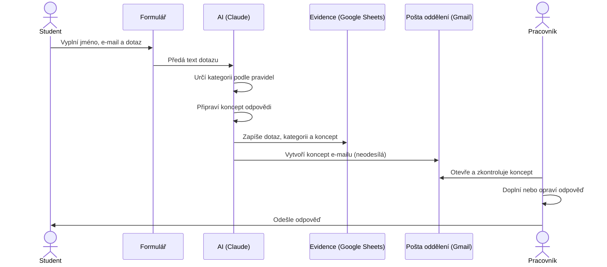
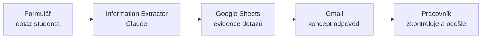
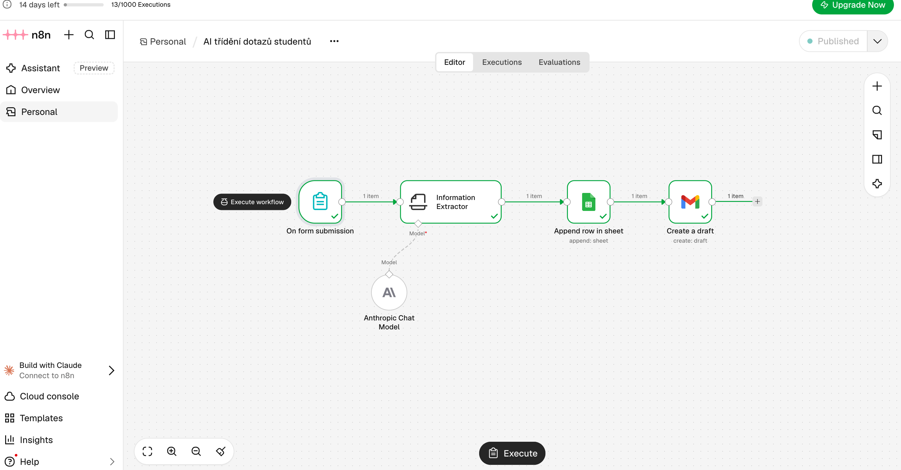
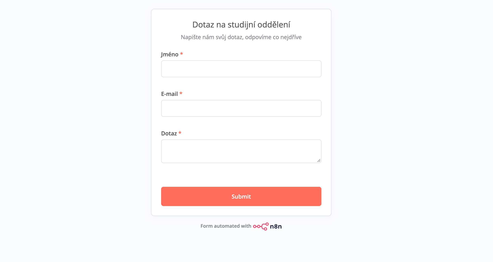
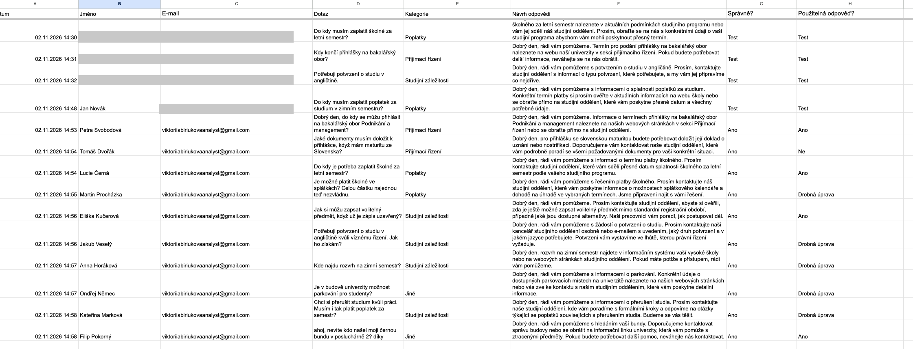
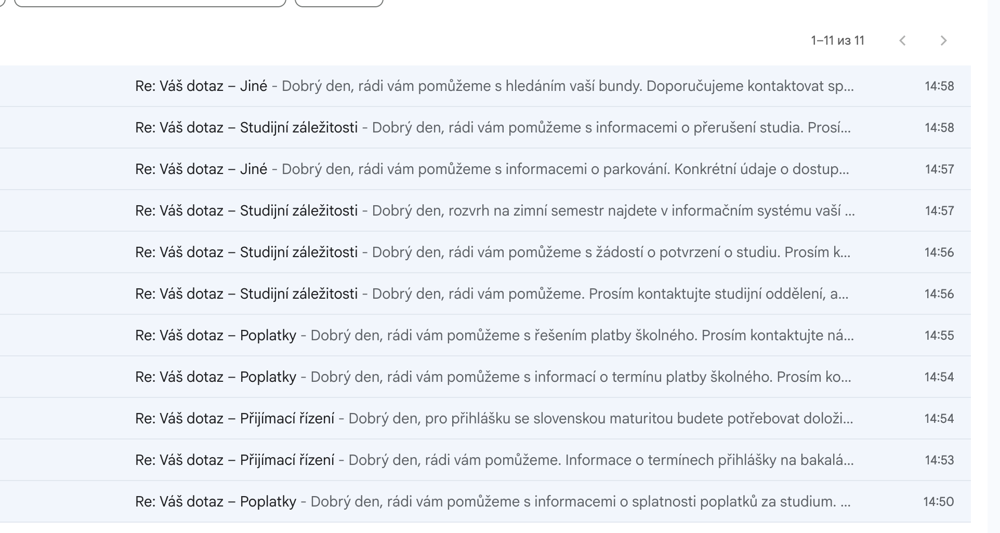

# AI třídění dotazů studentů — pilot v n8n

Malý pilotní projekt, ve kterém jsem ověřovala, jak může AI ulehčit práci studijního oddělení: automaticky roztřídit dotazy studentů a připravit koncept odpovědi, který pracovník jen zkontroluje a odešle.

**Výsledek:** 10 z 10 dotazů správně zařazeno, 9 z 10 konceptů odpovědí použitelných hned nebo po drobné úpravě.

> Projekt je ukázkový. Všechny dotazy, jména a e-maily jsou smyšlené, žádná reálná osobní data nebyla použita.

---

## Problém

Studijní oddělení dostává velké množství opakujících se dotazů: termíny přihlášek, školné, potvrzení o studiu, rozvrhy. Pracovníci je musí ručně číst, třídit a na každý psát odpověď. Je to rutina, která zabírá čas a zpomaluje odpovědi studentům.

## Cíl pilotu

Ověřit, zda AI dokáže spolehlivě:

1. **zařadit dotaz** do správné kategorie,
2. **připravit koncept odpovědi**, který pracovník jen zkontroluje,
3. **vést evidenci** všech dotazů na jednom místě.

Důležitá podmínka: **AI nic neodesílá sama.** Odpověď vždy schvaluje člověk (human-in-the-loop).

---

## Byznysový proces

### AS-IS: jak to funguje dnes

1. Student pošle dotaz e-mailem nebo přes web.
2. Pracovník studijního oddělení dotaz přečte a sám určí, o jaké téma jde.
3. Odpověď píše pokaždé od nuly, i když se stejné dotazy opakují.
4. Přehled o tom, kolik a jakých dotazů přichází, chybí, protože se nikde neevidují.

**Bolesti:** ruční rutina, pomalé odpovědi ve špičkách (přijímačky, začátek semestru), žádná data pro zlepšování služeb.

### TO-BE: jak to funguje s AI

1. **Student** vyplní krátký formulář: jméno, e-mail a dotaz.
2. **AI** dotaz přečte a podle předem nastavených pravidel ho zařadí do jedné ze 4 kategorií (Přijímací řízení, Studijní záležitosti, Poplatky, Jiné).
3. **AI** zároveň připraví koncept odpovědi: zdvořilý, stručný, jménem oddělení a bez vymyšlených termínů a částek.
4. **Systém** dotaz automaticky zapíše do evidenční tabulky: datum, kdo se ptá, na co, kategorie a návrh odpovědi.
5. **Systém** vytvoří v poště oddělení koncept e-mailu pro studenta. Nic se neodesílá automaticky.
6. **Pracovník** otevře koncept, zkontroluje ho, případně doplní konkrétní informaci a odešle.

### Role a odpovědnosti

| Role | Co dělá | Za co odpovídá |
|---|---|---|
| Student | Pošle dotaz přes formulář | Srozumitelně popsat dotaz |
| AI | Třídí dotazy a navrhuje odpovědi | Nic neodesílá, nevymýšlí si fakta |
| Pracovník oddělení | Kontroluje a odesílá odpovědi | Správnost a konečná podoba odpovědi |

### Přínosy

- **Méně rutiny:** pracovník nepíše odpověď od nuly, jen kontroluje a doplňuje.
- **Rychlejší reakce** ve špičkách, protože koncept je připravený okamžitě.
- **Data o dotazech:** evidence ukazuje, na co se studenti ptají nejčastěji, a z toho lze např. doplnit FAQ na webu.
- **Bezpečnost:** konečné rozhodnutí má vždy člověk.

---

## Technické řešení

| Krok | Uzel v n8n | Co dělá |
|---|---|---|
| 1 | On form submission | Webový formulář: jméno, e-mail, dotaz |
| 2 | Information Extractor + Anthropic Chat Model (Claude) | Určí kategorii a napíše koncept odpovědi ve strukturované podobě |
| 3 | Google Sheets: Append row | Zapíše dotaz, kategorii a koncept do tabulky (evidence) |
| 4 | Gmail: Create a draft | Vytvoří koncept e-mailu pro studenta, neodešle ho |

**Kategorie:** Přijímací řízení · Studijní záležitosti · Poplatky · Jiné

---

## Pravidla pro AI (prompt)

AI vrací dvě pole se zadanou strukturou:

| Pole | Popis pro AI |
|---|---|
| `Kategorie` | Kategorie dotazu. Vyber přesně jednu z: Přijímací řízení, Studijní záležitosti, Poplatky, Jiné |
| `navrh_odpovedi` | Krátká zdvořilá odpověď česky, kterou před odesláním zkontroluje pracovník studijního oddělení. Začni oslovením „Dobrý den,“ a buď stručný (max. 3 věty). Piš za studijní oddělení v 1. osobě množného čísla. **Nevymýšlej konkrétní data ani částky.** |

Poslední věta je ochrana proti halucinacím: AI nemá znát konkrétní termíny a částky univerzity, a proto si je nesmí vymýšlet.

### Ladění promptu

| Verze | Změna | Dopad |
|---|---|---|
| v1 | Základní popis polí | Odpovědi dlouhé (4–5 vět), bez oslovení |
| v1.1 | Přidáno oslovení a limit max. 3 věty | Odpovědi kratší a zdvořilejší |
| v1.2 | Psát za oddělení v 1. osobě množného čísla | Zmizelo „Rád/a vám pomohu“, odpovědi znějí jménem oddělení |
| v2 | Přidán koncept e-mailu v Gmailu | Pracovník dostane hotový koncept přímo do pošty |

---

## Testování

10 testovacích dotazů s předem známou správnou kategorií, včetně dvou záměrně obtížných:

- **dotaz se dvěma tématy** (přerušení studia + poplatek),
- **neformální dotaz mimo studium** („ahoj, nevíte kdo našel moji bundu…“).

Hodnotila jsem dvě věci: zda AI zařadila dotaz správně a zda je koncept odpovědi použitelný.

| # | Dotaz (zkráceně) | Očekávaná kategorie | AI | Správně | Odpověď |
|---|---|---|---|---|---|
| 1 | Termín přihlášky na bakalářský obor | Přijímací řízení | Přijímací řízení | ✅ | Použitelná |
| 2 | Dokumenty k přihlášce se slovenskou maturitou | Přijímací řízení | Přijímací řízení | ✅ | **Nepoužitelná** |
| 3 | Termín platby školného | Poplatky | Poplatky | ✅ | Použitelná |
| 4 | Školné ve splátkách | Poplatky | Poplatky | ✅ | Drobná úprava |
| 5 | Zápis volitelného předmětu po termínu | Studijní záležitosti | Studijní záležitosti | ✅ | Použitelná |
| 6 | Potvrzení o studiu v angličtině | Studijní záležitosti | Studijní záležitosti | ✅ | Drobná úprava |
| 7 | Kde najdu rozvrh | Studijní záležitosti | Studijní záležitosti | ✅ | Drobná úprava |
| 8 | Parkování pro studenty | Jiné | Jiné | ✅ | Drobná úprava |
| 9 | Přerušení studia a poplatek *(dvě témata)* | Studijní z. / Poplatky | Studijní záležitosti | ✅ | Drobná úprava |
| 10 | Ztracená bunda *(neformální, mimo studium)* | Jiné | Jiné | ✅ | Použitelná |

## Výsledky

| Ukazatel | Výsledek |
|---|---|
| Správně zařazené dotazy | **10 / 10** |
| Koncept použitelný hned | **4 / 10** |
| Koncept po drobné úpravě | **5 / 10** |
| Nepoužitelný koncept | **1 / 10** |

---

## Zjištění

1. **Třídění dotazů lze AI svěřit.** Zařadila správně všech 10 dotazů včetně dotazu se dvěma tématy a neformálního dotazu mimo studium.
2. **Kontrola člověkem je nutná.** V dotazu č. 2 AI uvedla požadavek na uznání / nostrifikaci slovenské maturity, který podle mých informací neplatí. Taková odpověď by mohla studenta uvést v omyl.
3. **AI má sklon slibovat.** V odpovědích se objevily sliby („najdeme řešení“, „vystavíme ve lhůtě…“), které by oddělení nemuselo dodržet.
4. **Bez znalostní báze AI odpovídá obecně.** Většina odpovědí odkazuje na studijní oddělení, protože AI nezná konkrétní pravidla univerzity.
5. **Drobné chyby v jazyce a perspektivě.** Např. „vaší vysoké školy“ místo „naší“, „Budeme se vás těšit“, u parkování odkaz na nesprávné oddělení.

## Rizika a odpovědné využití AI

- **Ochrana osobních údajů (GDPR):** dotazy obsahují jména a e-maily. Pro reálný provoz je nutné použít AI službu schválenou univerzitou, se smlouvou o zpracování dat. Bezplatné verze AI nástrojů mohou data použít ke zlepšování svých modelů.
- **Halucinace:** AI si může vymyslet pravidla nebo termíny, proto odpověď vždy kontroluje pracovník.
- **Transparentnost (AI Act):** student by měl vědět, že odpověď připravila AI a schválil ji člověk.

## Další kroky

1. **Znalostní báze (RAG):** napojit AI na FAQ a předpisy univerzity, aby odpovídala podle skutečných pravidel, a ne obecně.
2. **Směrování podle kategorie:** dotazy na poplatky posílat rovnou na ekonomické oddělení, na přijímačky na příslušné oddělení.
3. **Schvalování v jednom kroku:** pracovník odpověď schválí nebo upraví jedním klikem (např. uzel „Send and wait for response“).
4. **Měření přínosu:** porovnat, kolik času zabere odpověď ručně a s konceptem od AI.

---

## Použité nástroje

n8n · Claude (Anthropic) · Google Sheets · Gmail

## Snímky obrazovky

**Workflow v n8n**

**Formulář pro studenty**

**Evidence dotazů v Google Sheets**

**Koncepty odpovědí v Gmailu**

## Soubory

- [`workflow.json`](workflow.json): export workflow z n8n. Přístupové údaje, ID tabulky a adresa formuláře jsou nahrazeny zástupnými hodnotami. Po importu do n8n stačí připojit vlastní účty Google a model AI.
