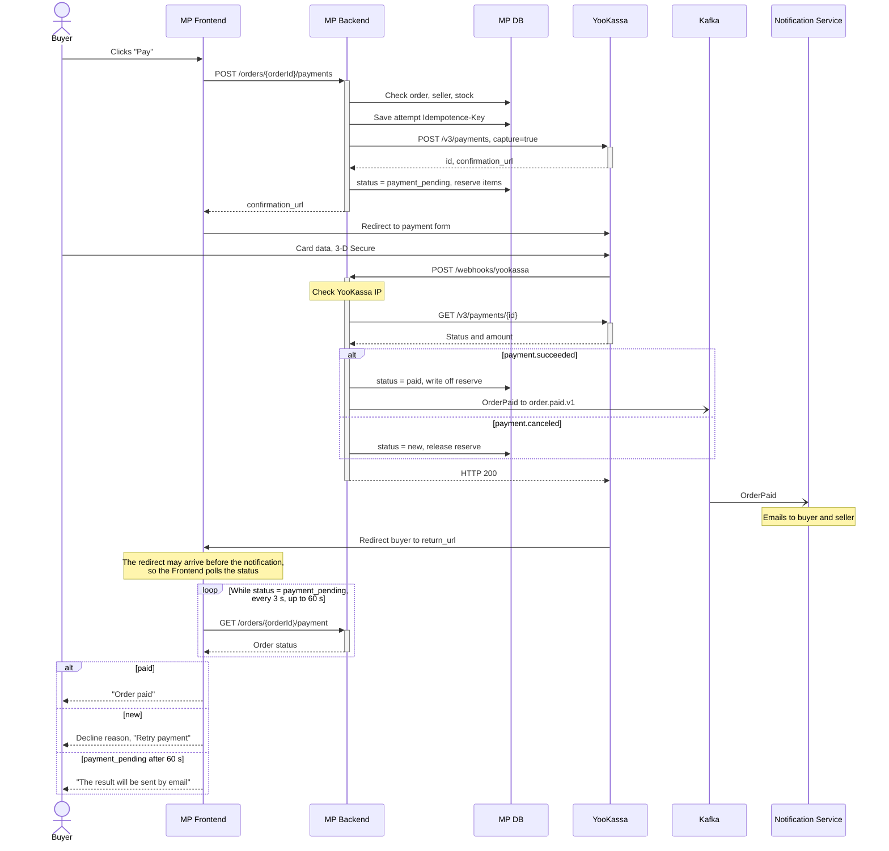

# YooKassa Integration for Marketplace N [Technical Use Case]

> About the project: Marketplace N (MP) sells jewelry from small brands and independent makers. Sellers operate as sole proprietors or LLCs. Payments go through YooKassa using its marketplace scheme with split payments. The company name and data have been changed.

**Contents**

- [Overview](#overview)
  - [External system API documentation](#external-system-api-documentation)
  - [Specifics and known issues](#specifics-and-known-issues)
- [Use Case](#use-case)
  - [User roles](#user-roles)
  - [Systems](#systems)
  - [Preconditions](#preconditions)
  - [Main flow](#main-flow)
  - [Alternative flows and error handling](#alternative-flows-and-error-handling)
  - [Postconditions](#postconditions)
- [Data mapping](#data-mapping)
- [Request and response examples](#request-and-response-examples)
- [Appendix: UML Sequence of the payment process](#appendix-uml-sequence-of-the-payment-process)

## Overview

This document describes online order payment in the MP web application via YooKassa.

**What it is:**

Integration of the MP Backend with YooKassa to accept order payments securely.

**Why:**

- Enable online payment so the buyer pays right at checkout.
- Avoid receiving or storing card data: the buyer enters it on the YooKassa side.
- Split the payment automatically: the seller's share goes to the seller's YooKassa store, and the commission stays with MP.

**For whom:**

- Buyers who want to pay for jewelry online quickly and securely.
- Sellers who don't need their own cash register or acquiring.
- MP owners who earn a commission on every payment.

### External system API documentation

- [Split payments: overview](https://yookassa.ru/developers/solutions-for-platforms/marketplaces/basics)
- [Accepting split payments](https://yookassa.ru/developers/solutions-for-platforms/marketplaces/payments)
- [YooKassa API reference](https://yookassa.ru/developers/api)

### Specifics and known issues

1. Before starting work on the task, the following must be configured:
   1. the MP store ID (shopId) and secret key;
   2. the URL for YooKassa notifications;
   3. the seller's YooKassa store `account_id` in the profile of each verified seller.
2. An order contains items from one seller only. A cart with items from several sellers is split into orders, each paid separately.
3. The seller handles delivery, so the full order amount including delivery is transferred to the seller, and MP withholds its commission. ⚠️ TBD: if MP takes over delivery, the delivery cost must be excluded from `transfers[0].amount`.
4. SBP (Faster Payments System) is not supported with split payments.
5. Fiscal receipts (Federal Law 54-FZ) are not sent in the payment request; YooKassa accepts them in a separate request. Receipt generation is a separate task in the Backlog.
6. Refunds after payment are not supported yet and are in the Backlog. An administrator issues refunds manually in the YooKassa dashboard.
7. Order statuses in this flow. MP order statuses and YooKassa payment statuses differ: the order uses `cancelled`, the YooKassa payment uses `canceled`.

| Order status | Meaning | YooKassa payment status |
| --- | --- | --- |
| `new` | Order created, no payment yet or the previous attempt failed | none or `canceled` |
| `payment_pending` | Payment created, buyer is on the payment form | `pending` |
| `paid` | Order paid | `succeeded` |
| `cancelled` | Order cancelled: payment not received within 30 minutes | `pending` expired or no payment |

## Use Case

### User roles

- Buyer.
- Seller. Not active in this flow, receives a notification about the new paid order.

### Systems

- MP Frontend (buyer web application)
- MP Backend
- MP DB
- Kafka
- MP Notification Service (sends emails)
- YooKassa

### Preconditions

- The buyer is logged in, the order is created with status `new`, and all its items are from one seller.
- The seller is verified and has a YooKassa store `account_id`.
- The buyer is on the checkout screen, delivery is selected and calculated.
- The screen asks the buyer to check the recipient's full name, phone and email. The payment confirmation will be sent to this email.

### Main flow

1. The buyer checks the full name, phone and email.
2. The buyer clicks "Pay".
3. The Frontend checks that the data is complete and correctly formatted and sends `POST /orders/{orderId}/payments` to the MP Backend.
4. The MP Backend:
   1. validates the format of the full name, phone and email;
   2. checks in the DB by `{orderId}` that the order belongs to the buyer and has status `new`;
   3. checks that the seller is verified and the items are in stock;
   4. calculates the order amount and the MP commission;
   5. generates an `Idempotence-Key` for this payment attempt and saves it to the DB. Retries for this attempt use the same key, so YooKassa will not create a second payment.
5. The MP Backend sends a create payment request `POST /v3/payments` to YooKassa with the `Idempotence-Key` header. The mapping is described in [Data mapping](#data-mapping).
6. YooKassa responds with:
   1. `id`: the payment ID in YooKassa;
   2. `confirmation.confirmation_url`: a link to the YooKassa payment form. The buyer enters card data on the YooKassa side, MP has no access to it.
7. The MP Backend saves `id` and `confirmation_url` to the DB, reserves the items for 30 minutes and updates the order status: `status = payment_pending`.
8. The MP Backend returns the order and payment data to the Frontend, including `confirmation_url`.
9. The Frontend redirects the buyer to the YooKassa payment form.
10. The buyer enters card data and completes 3-D Secure on the YooKassa side.
11. YooKassa charges the card, credits the seller's share to the seller's store and the commission to MP, and in parallel:
    1. notifies the MP Backend of the result: a `payment.succeeded` notification to `POST /webhooks/yookassa`;
    2. redirects the buyer to `return_url`.
12. The MP Backend:
    1. checks that the notification came from a YooKassa IP address;
    2. finds the order by `metadata.order_id`, requests the current status via `GET /v3/payments/{id}` and checks the amount against the order;
    3. updates the order status to `status = paid` and writes off the reserved items;
    4. publishes an `OrderPaid` event to the Kafka topic `order.paid.v1`. The Notification Service reads the event and emails a payment confirmation to the buyer and a new order notice to the seller;
    5. responds to YooKassa with HTTP 200.
13. The Frontend gets the status via `GET /orders/{orderId}/payment` and shows the "Order paid" screen.

### Alternative flows and error handling

**Alternative flow 1. YooKassa is temporarily unavailable.** Starts at step 5.

1. YooKassa did not respond within 10 seconds or returned HTTP 500.
2. The MP Backend retries the request once with the same `Idempotence-Key`. Thanks to this key, YooKassa will not create a second payment if the first one went through.
3. If a response is received, go to step 6 of the main flow.
4. If there is still no response, the MP Backend logs a warning and returns HTTP 500 to the Frontend. The whole wait fits into 25 seconds, under the 30-second Frontend timeout.

   ```json
   { "message": "Service is temporarily unavailable. Please try again" }
   ```

5. The Frontend shows the message from the response. Return to step 2 of the main flow.

**Alternative flow 2. YooKassa rejected the request.** Starts at step 5.

1. YooKassa returned HTTP 401 (invalid store key) or HTTP 400 (invalid request data).
2. The MP Backend does not retry and logs a critical error.
3. The MP Backend returns HTTP 500 to the Frontend.

   ```json
   { "message": "Service is temporarily unavailable. Please try later" }
   ```

4. The Frontend shows the message from the response. The flow ends.

**Alternative flow 3. The bank declined the payment.** Starts at step 11.

1. YooKassa sends a `payment.canceled` notification with the reason.

   ```json
   {
     "type": "notification",
     "event": "payment.canceled",
     "object": {
       "id": "2e8a9f7c-000f-5000-9000-1b6c4a2d3e4f",
       "status": "canceled",
       "paid": false,
       "cancellation_details": { "party": "payment_network", "reason": "insufficient_funds" },
       "metadata": { "order_id": "8f3c1e2a-5b7d-4e1f-9a2c-3d4e5f6a7b8c" }
     }
   }
   ```

2. The MP Backend validates the notification as in steps 12.1 and 12.2.
3. The MP Backend releases the reserved items, returns the order to `new`, saves the decline reason and responds to YooKassa with HTTP 200.
4. The Frontend requests the status via `GET /orders/{orderId}/payment` and gets:

   ```json
   {
     "orderId": "8f3c1e2a-5b7d-4e1f-9a2c-3d4e5f6a7b8c",
     "status": "new",
     "payment": { "status": "canceled", "cancelReason": "insufficient_funds" }
   }
   ```

5. The Frontend shows "Insufficient funds on the card" and a "Retry payment" button.
6. Return to step 2 of the main flow. The retry uses a new `Idempotence-Key`.

**Alternative flow 4. The buyer did not pay within 30 minutes.** Starts at step 10.

1. The buyer closed the payment form, no notification comes from YooKassa.
2. After 30 minutes, an MP Backend background job releases the reserved items and moves the order to `cancelled`.
3. If the payment arrives later anyway, the MP Backend does not change the order status, logs a warning and creates a task for the administrator to refund the money via the YooKassa dashboard. ⚠️ TBD: automatic refunds are in the Backlog.
4. The flow ends.

**Alternative flow 5. The YooKassa notification did not arrive.** Starts at step 12.

1. The buyer paid, but the notification did not reach the MP Backend.
2. Every 5 minutes, an MP Backend background job requests `GET /v3/payments/{id}` for orders in `payment_pending`.
3. The MP Backend handles the response like a notification: on `"status": "succeeded"` go to step 12.3 of the main flow, on `"status": "canceled"` go to step 3 of alternative flow 3.

⚠️ TBD: other flows (input errors, duplicate and forged notifications, no connection to the MP Backend) are described separately.

### Postconditions

- The order is in `paid` status, the items are written off from stock.
- The YooKassa payment is in `succeeded` status: the seller's share is credited to the seller's store, the commission stays with MP.
- The buyer received a payment email, the seller received a new order notification.

## Data mapping

MP fields are given as `table.field` in the MP DB: `orders` (order), `sellers` (seller), `payments` (payment attempt).

### Request MP → YooKassa: create payment `POST /v3/payments` (step 5)

| YooKassa field | MP DB field | Rule | Example |
| --- | --- | --- | --- |
| `Idempotence-Key` header | `payments.idempotence_key` | UUID, generated at step 4.5 | `6b1f0c2e-7d3a-…` |
| `amount.value` | `orders.total_amount` | string with two decimal places | `"17000.00"` |
| `amount.currency` | constant | always `RUB` | `"RUB"` |
| `capture` | constant | always `true` | `true` |
| `confirmation.type` | constant | always `redirect` | `"redirect"` |
| `confirmation.return_url` | `orders.id` | `https://mp.example/orders/{orders.id}/payment-result` | `https://mp.example/orders/8f3c1e2a-…/payment-result` |
| `description` | `orders.number` | "Order No. " + number | `"Order No. 10452"` |
| `metadata.order_id` | `orders.id` | unchanged | `"8f3c1e2a-…"` |
| `transfers[0].account_id` | `sellers.yookassa_account_id` | seller by `orders.seller_id` | `"123456"` |
| `transfers[0].amount.value` | `orders.total_amount` | same as `amount.value` (see specific 3) | `"17000.00"` |
| `transfers[0].platform_fee_amount.value` | `payments.platform_fee` | `orders.total_amount` × `sellers.commission_rate`, rounded to kopecks. ⚠️ TBD: rate | `"1700.00"` |
| `transfers[0].description` | `sellers.legal_name`, `orders.total_amount`, `orders.number` | seller's legal name, amount and order number; YooKassa requires the name and amount | `"IE Smirnova A. V. 17000 RUB, order No. 10452"` |

### Response and notification YooKassa → MP (steps 6, 7 and 12)

These fields come in the response to `POST /v3/payments` and in the payment result notification. The "Comes in" column shows where.

| YooKassa field | Comes in | MP DB field | Rule | Example |
| --- | --- | --- | --- | --- |
| `id` | response | `payments.external_id` | saved at step 7 | `"2e8a9f7c-000f-…"` |
| `confirmation.confirmation_url` | response | `payments.confirmation_url` | saved at step 7, returned to the Frontend | `"https://yoomoney.ru/checkout/…"` |
| `status` | response and notification | `payments.status`, `orders.status` | `pending` → order `payment_pending`, `succeeded` → `paid`, `canceled` → `new` | `"succeeded"` |
| `metadata.order_id` | notification | `orders.id` | used to find the order | `"8f3c1e2a-…"` |
| `amount.value` | notification | `orders.total_amount` | checked; on mismatch, critical log entry and the status is not changed | `"17000.00"` |
| `captured_at` | notification | `payments.paid_at` | saved on `succeeded` | `"2026-10-22T09:48:40.000Z"` |
| `cancellation_details.reason` | notification | `payments.cancel_reason` | saved on `canceled`, shown to the buyer | `"insufficient_funds"` |

The recipient's full name, phone and email from `POST /orders/{orderId}/payments` are saved to `orders.recipient_full_name`, `orders.recipient_phone` and `orders.recipient_email`. They are not sent to YooKassa; they are used for the buyer's email.

## Request and response examples

The values in the examples are illustrative. Only requests and responses produced by MP are shown here. The YooKassa response and payment result notification are described in the [YooKassa documentation](https://yookassa.ru/developers/api), and the fields MP reads from them are listed in "Data mapping".

### MP API: create payment (step 3)

Request:

```http
POST /orders/8f3c1e2a-5b7d-4e1f-9a2c-3d4e5f6a7b8c/payments
Authorization: Bearer <buyer token>
Content-Type: application/json

{
  "recipient": {
    "fullName": "Anna Sergeevna Ivanova",
    "phone": "+79161234567",
    "email": "anna@example.com"
  }
}
```

Response HTTP 201:

```json
{
  "orderId": "8f3c1e2a-5b7d-4e1f-9a2c-3d4e5f6a7b8c",
  "orderNumber": "10452",
  "status": "payment_pending",
  "amount": { "value": "17000.00", "currency": "RUB" },
  "payment": {
    "id": "2e8a9f7c-000f-5000-9000-1b6c4a2d3e4f",
    "status": "pending",
    "confirmationUrl": "https://yoomoney.ru/checkout/payments/v2/contract?orderId=2e8a9f7c-000f-5000-9000-1b6c4a2d3e4f"
  }
}
```

### YooKassa: create payment (step 5)

```http
POST https://api.yookassa.ru/v3/payments
Authorization: Basic <shopId:secret key in Base64>
Idempotence-Key: 6b1f0c2e-7d3a-4f5b-8e9c-0a1b2c3d4e5f
Content-Type: application/json

{
  "amount": { "value": "17000.00", "currency": "RUB" },
  "capture": true,
  "confirmation": {
    "type": "redirect",
    "return_url": "https://mp.example/orders/8f3c1e2a-5b7d-4e1f-9a2c-3d4e5f6a7b8c/payment-result"
  },
  "description": "Order No. 10452",
  "metadata": { "order_id": "8f3c1e2a-5b7d-4e1f-9a2c-3d4e5f6a7b8c" },
  "transfers": [
    {
      "account_id": "123456",
      "amount": { "value": "17000.00", "currency": "RUB" },
      "platform_fee_amount": { "value": "1700.00", "currency": "RUB" },
      "description": "IE Smirnova A. V. 17000 RUB, order No. 10452"
    }
  ]
}
```

### MP API: payment status (step 13)

Request:

```http
GET /orders/8f3c1e2a-5b7d-4e1f-9a2c-3d4e5f6a7b8c/payment
Authorization: Bearer <buyer token>
```

Response HTTP 200:

```json
{
  "orderId": "8f3c1e2a-5b7d-4e1f-9a2c-3d4e5f6a7b8c",
  "status": "paid",
  "payment": {
    "id": "2e8a9f7c-000f-5000-9000-1b6c4a2d3e4f",
    "status": "succeeded",
    "paidAt": "2026-10-22T09:48:40.000Z"
  }
}
```

## Appendix: UML Sequence of the payment process

The UML Sequence diagram shows the order of calls in the main flow. Errors are covered in the alternative flows.

Notation: a solid arrow with a filled head is a synchronous call, a dashed arrow is a response, an arrow with an open head is an asynchronous message via Kafka.


