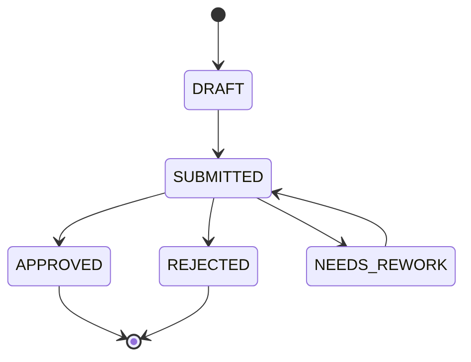

# Seller Applications · API Contract

**OpenAPI 3.1 + AsyncAPI 2.6 + Kafka + ReDoc + Prism**

Part of the Marketplace N project documentation, seller applications module. The company name, legal details and seller data have been changed.

Marketplace N sells jewelry from small brands and independent makers. To start selling, a seller submits an application with documents, and a marketplace lawyer reviews it and makes a decision.

## API operations

```text
GET   /seller-applications                           List applications with filters and pagination
POST  /seller-applications                           Create an application
GET   /seller-applications/{applicationId}           Get an application
PATCH /seller-applications/{applicationId}           Update application data
POST  /seller-applications/{applicationId}/submit    Submit for review
POST  /seller-applications/{applicationId}/decision  Make a decision (lawyer)
POST  /seller-applications/{applicationId}/archive   Move to archive
POST  /seller-applications/{applicationId}/restore   Restore from archive
```

Each operation describes the request, response, response codes and examples for both success and error cases. Errors share a single format.

## Application statuses



- creating an application, status `DRAFT`: `POST /seller-applications`;
- submitting and resubmitting for review, status `SUBMITTED`: `POST .../submit`;
- lawyer's decision, status `APPROVED`, `REJECTED` or `NEEDS_REWORK`: `POST .../decision`.

## Key decisions

- **PATCH instead of PUT.** The seller sends only the changed fields, for example a new email, instead of the whole application.
- **Archive instead of delete.** Applications are kept for the review history, so they are archived rather than deleted. The status is preserved and the application can be restored.
- **One endpoint for the lawyer's decision.** Approve, reject and return for rework all go through `/decision`, since these actions share the same validation rules.
- **Events via Kafka.** When an application status changes, the applications service publishes an event to Kafka, and the notification service emails the seller. The services do not depend on each other.

## What's inside

```text
openapi/      REST API: operations, parameters, responses
asyncapi/     Status change event in Kafka
schemas/      Data schemas
examples/     Request, response and event examples
docs/         Status diagram
scripts/      Documentation build and demo launch
```

## How to run

You need Git and Node.js 22.

```bash
git clone https://github.com/viiktoriia0990-del/system-analyst-portfolio-en.git
cd system-analyst-portfolio-en/seller-verification
npm install
npm run demo
```

| What | Address |
|---|---|
| API documentation (ReDoc) | http://localhost:8080 |
| Event documentation (AsyncAPI) | http://localhost:8080/asyncapi |
| Mock server (Prism) | http://localhost:4010 |

To stop the demo, press `control + C` in the terminal.

